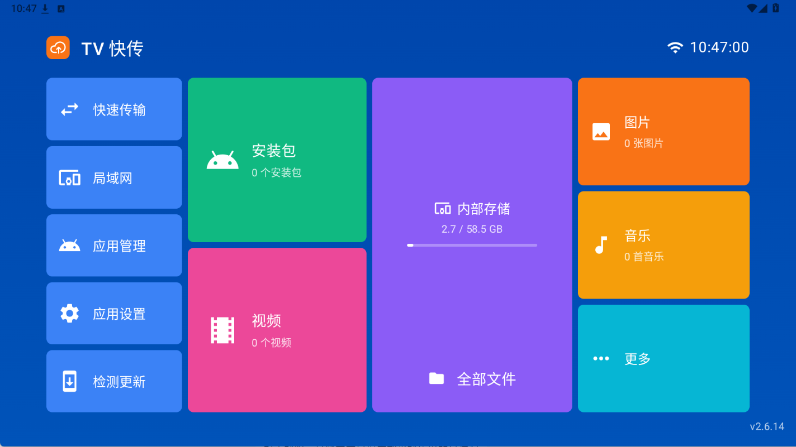
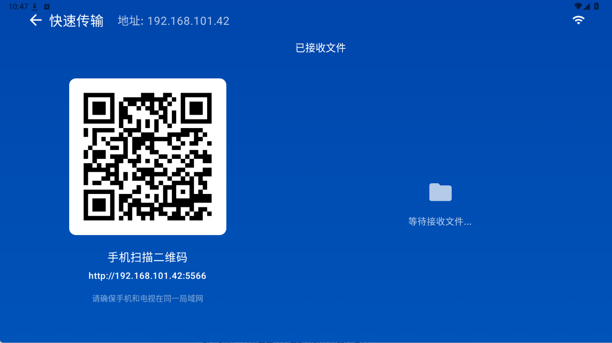
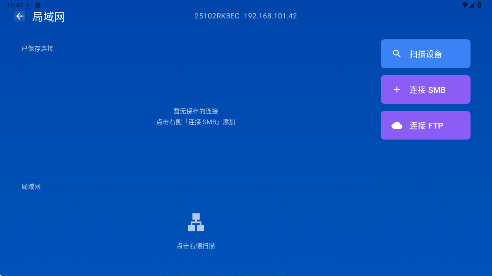
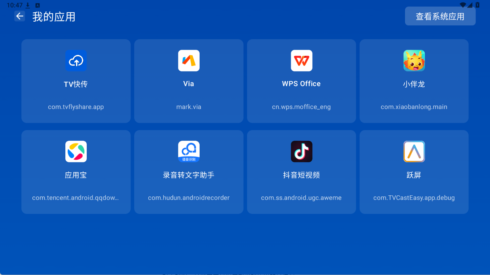
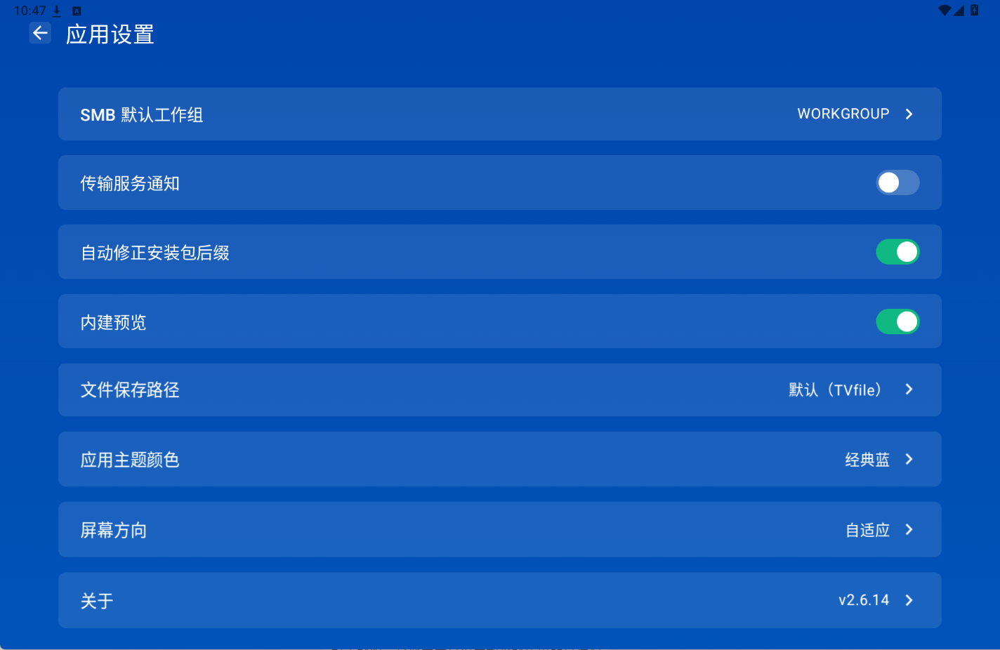
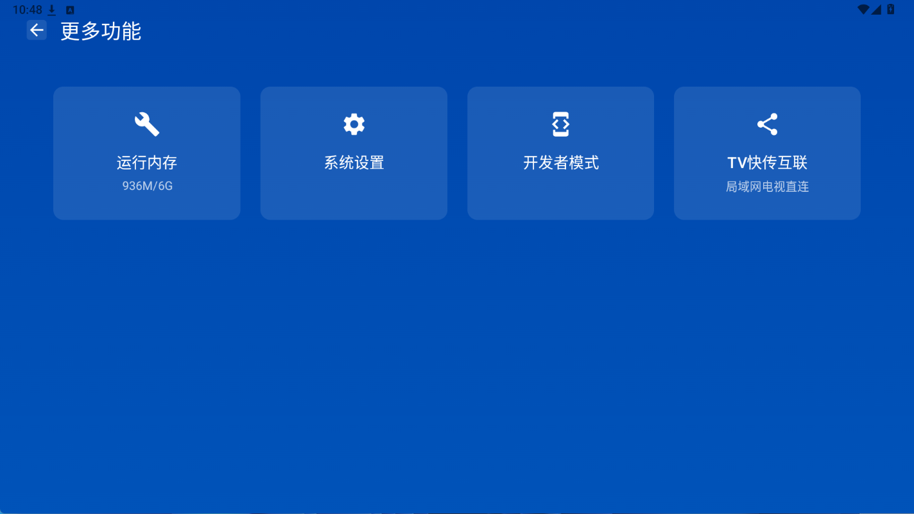
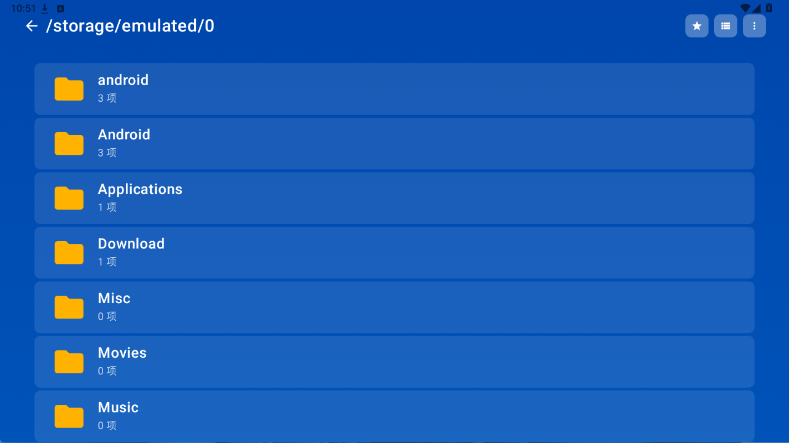

# FlyShare（TV 快传）

局域网内的电视 / 车机文件传输工具。让电视和手机、电脑在同一个 WiFi 下互传文件、管理共享目录，不用数据线、不用装电脑端。

## 功能

- **设备互联与文件传输**：内建 HTTP 服务 + UDP 组播发现，同局域网设备一键互传
- **SMB 共享管理**：浏览、复制、移动、下载局域网 SMB 共享目录里的文件
- **本地文件管理**：分类浏览电视本机文件、卸载应用等
- **网页端**：手机 / 电脑浏览器即可访问，支持建文件夹、拖拽上传整个文件夹
- **可自定义保存位置**：设置里可改接收 / 下载的落盘目录
- **安装包后缀自动修正**：自动还原被改名的 `.apk1` / `.apk.1`（可用开关关闭）

运行平台：Android TV / 深度定制车机系统（兼容普通 Android 设备）。

## 界面预览

首页：文件分类、快速传输、局域网、应用管理与设置入口。



快速传输：手机扫二维码即可打开网页端，免登录互传文件。



局域网：扫描设备，连接 SMB / FTP 共享。



应用管理：查看、卸载电视上已安装的应用。



应用设置：SMB 工作组、文件保存路径、主题颜色、屏幕方向等。



更多功能：运行内存、系统设置、开发者模式、电视互联。



文件管理器：浏览电视本机目录，支持复制、移动、删除等操作。



> 截图取自 v2.6.14 的 Android TV 实机界面；画面中的 192.168.x.x 是局域网地址，不是公网地址。

## 安全须知

- **服务不鉴权**：为了让手机 / 电脑免登录直接传文件，内建服务是明文 HTTP、不校验身份。**连入同一 WiFi 的任何人都能浏览、下载你设为共享目录里的文件，也能上传和删除。**请只在可信网络（家庭或办公内网）使用，不要在公共 WiFi 下开启，也不要做端口转发 / 内网穿透。
- 应用需要整机文件访问权限才能浏览和管理电视本机目录，请按需授予。
- 升级包与 OTA 配置托管在对象存储上，客户端按配置里的文件指纹校验后安装。

## 技术栈

Kotlin · Jetpack Compose（Material 3，按宽度类 × 高度类适配 TV / 平板 / 手机）· MVVM + StateFlow ·
NanoHTTPD（HTTP 服务）· smbj（SMB）· UDP 组播（设备发现）· Kotlin Coroutines · ZXing。

## 目录

| 路径 | 说明 |
| --- | --- |
| `app-android/` | Android 工程（Gradle + Kotlin + Compose） |
| `app-android/app/src/` | 主应用源码与单元测试 |
| `LICENSE` | MIT 许可证 |
| `THIRD-PARTY-LICENSES` | 第三方依赖许可声明 |

## 如何编译

环境要求：JDK 17、Android SDK（含对应平台与构建工具）、本地 `local.properties` 配置 `sdk.dir` 指向 SDK 路径（该文件不入库）。

工程自带 `app-android/gradle.properties`（只含 `android.useAndroidX` 等公共构建参数，已入库），
**不需要任何密钥即可编译**：调试版使用 Android 自动生成的默认调试签名。

```bash
cd app-android

# Windows
gradlew.bat :app:assembleDebug

# macOS / Linux
./gradlew :app:assembleDebug
```

构建正式包：

```bash
gradlew.bat :app:assembleRelease
```

产物位于 `app/build/outputs/apk/release/FlyShare-<版本号>.apk`（Gradle 已按 `APP_VERSION_NAME` 自动钉名，不再产出 `app-release.apk`）。

### 关于签名

未配置签名时，`assembleRelease` 产出的是**未签名包**，只能用于编译验证，不能安装或发布。

工程自带 `app-android/gradle.properties`（公共构建参数，已入库），**不要往里写任何密钥**。
正式签名请通过环境变量、命令行 `-P` 参数或用户级 `~/.gradle/gradle.properties` 提供**你自己生成的**
keystore 信息，具体见 [`app-android/LOCAL-CONFIG.md`](app-android/LOCAL-CONFIG.md)。
`keystore/` 不入库，签名密钥永远不要放进仓库。

自己编译的包与官方发布包签名不同，因此**不能覆盖安装**、也**不会接收官方自动升级**。这是 Android 的正常行为，
也保证没有人能冒充官方推送升级包。

### 关于自动升级地址

应用读取的更新配置地址由 `UPDATE_JSON_URL` 注入（见 `app/build.gradle.kts` 的 `buildConfigField`），
该值同样通过 `LOCAL-CONFIG.md` 里的三种方式提供，不写进被跟踪文件。
不配置时默认指向 GitHub Releases 模板：

```
https://github.com/kakyla/FlyShare/releases/latest/download/update.json
```

上面是本项目仓库的默认地址；如果你 fork 了这份代码，请改成你自己的仓库路径或更新服务器地址。更新配置文件形如：

```json
{
  "versionCode": 20614,
  "versionName": "2.6.14",
  "apkUrl": "https://<你的地址>/FlyShare-2.6.14.apk",
  "apkSha256": "<APK 的 SHA-256 指纹>",
  "updateLog": "更新内容说明"
}
```

客户端会比较 `versionCode` 决定是否升级，并在安装前用 `apkSha256` 校验包完整性。

> 当前 release 构建开启 R8 混淆与资源压缩。混淆后的崩溃堆栈需用 `app/build/outputs/mapping/release/mapping.txt` 反混淆。

## 开源许可

本项目源码采用 [MIT 许可证](LICENSE)。第三方依赖的许可证声明见 [THIRD-PARTY-LICENSES](THIRD-PARTY-LICENSES)。

## 免责声明

本软件按"原样"提供，不提供任何明示或暗示的担保。使用本软件进行文件传输、网络共享等操作所产生的风险与责任由用户自行承担。请在合法合规的场景下使用。

## 反馈

使用中有问题或建议，欢迎通过应用「关于」页的联系方式反馈。
